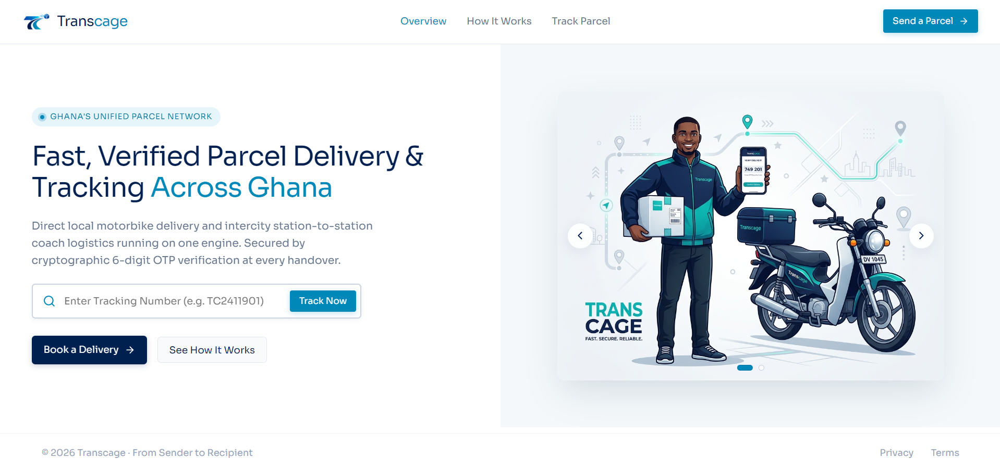

# Transcage 🇬🇭
### Ghana's Unified Parcel Delivery & Tracking Network

Fast, verified parcel logistics connecting direct door-to-door couriers and intercity coach terminals on a single, secure engine.

---



---

## Overview

In Ghana, sending a parcel typically requires navigating disconnected channels: unvetted motorbike riders for local trips, or informal bus terminal parcel counters with paper receipts and no tracking. 

**Transcage** unites both workflows onto one reliable, technology-driven platform:

1. **Local Same-City Courier (P2P):** On-demand motorbike and vehicle pickup from your doorstep straight to the recipient, with live GPS tracking.
2. **Intercity Station-to-Station:** Intercity freight dispatched across Ghana through established coach operators and bus terminal networks (STC, GPRTU, and partner operators).

Whether moving documents across Accra or freight between Takoradi, Kumasi, and Tamale, Transcage ensures every parcel has clear pricing, verified chain-of-custody, and complete visibility.

---

## Key Highlights

- **🔒 Cryptographic 6-Digit OTP Handover**  
  Every physical transfer—from sender to driver, clerk to coach, and courier to recipient—is verified through an explicit 6-digit one-time code. No parcel is released without verified authorization.

- **📍 Real-Time Tracking & Public Waybill Search**  
  Senders and recipients can track parcel movement in real time with milestone updates and live maps. Recipients do not even need an app account—they can view live status via their unique tracking code (e.g., `TC2411901`).

- **⚡ Instant, Transparent Pricing**  
  Transparent rate calculation based on real route distance, parcel dimensions, weight, and service category. Supports local Mobile Money (MoMo) payments and Pay-on-Delivery options.

- **🛡️ Cargo Protection Guarantee**  
  Optional declared-value cargo insurance with an immutable audit log recording every handover event, timestamp, and location.

- **🚌 Multi-Operator & Multi-Leg Hub Routing**  
  Built to support multiple coach operators and scheduled line-hauls, including multi-leg relay routes across intermediate transfer hubs.

---

## How It Works

```
1. Instant Quote & Booking ──► 2. Verified Custody Handover ──► 3. Live Tracking & Delivery Release
   • Choose P2P or Station         • Sender provides pickup OTP       • Live GPS transit updates
   • Transparent distance fare     • Custody logged in audit ledger   • Recipient OTP verifies delivery
```

1. **Book in Seconds:** Select your pickup landmark or coach terminal, enter parcel details, and get an immediate fixed quote.
2. **Secure Handover:** The driver or terminal clerk checks in the parcel by verifying your secure 6-digit sender OTP.
3. **Track & Collect:** Follow the courier or coach in real time. Upon arrival, the recipient provides their release OTP to finalize delivery and trigger instant settlement.

---

## Built for Every Stakeholder

| Role | Capabilities |
| :--- | :--- |
| **Customers & Businesses** | Instant quotes, doorstep pickup, bulk bookings, digital receipts, and end-to-end parcel tracking. |
| **Couriers & Drivers** | Broadcast job alerts, direct assignment, verified custody handovers, and automated digital earnings payouts. |
| **Station Clerks & Staff** | Digital parcel intake, barcode/QR terminal scanning, vehicle manifest loading, and counter collection. |
| **Terminal Operators** | Route configuration, multi-station branch management, fleet performance oversight, and ledger settlements. |

---

## Platform Structure

- **Web Portal (`/frontend`):** Modern, responsive interface built with React, Vite, and Lucide icons for customers, couriers, and station operators.
- **Backend Services (`/backend`):** Core orchestration engine managing unified shipment state machines, dynamic pricing policies, OTP generation, and real-time event distribution.
- **Database (`/database`):** Relational MySQL schema powering parcel lifecycles, ledger accounting, custody events, and multi-operator profiles.

---

## Quick Start (Local Setup)

To explore or run the client web application locally:

```bash
# 1. Navigate to frontend directory
cd frontend

# 2. Install dependencies
npm install

# 3. Start local development server
npm run dev
```

Build for production:
```bash
npm run build
```

---

<p align="center">
  <sub>© 2026 Transcage · From Sender to Recipient · Fast. Secure. Reliable.</sub>
</p>
